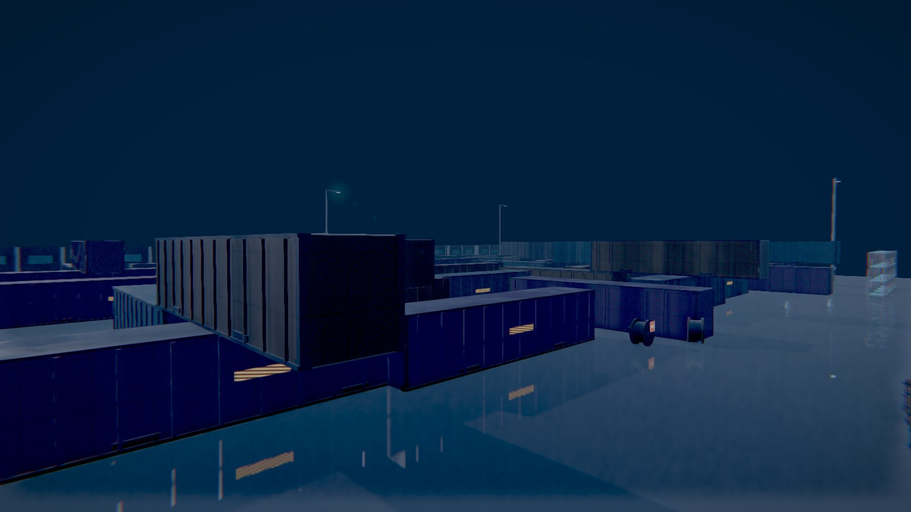
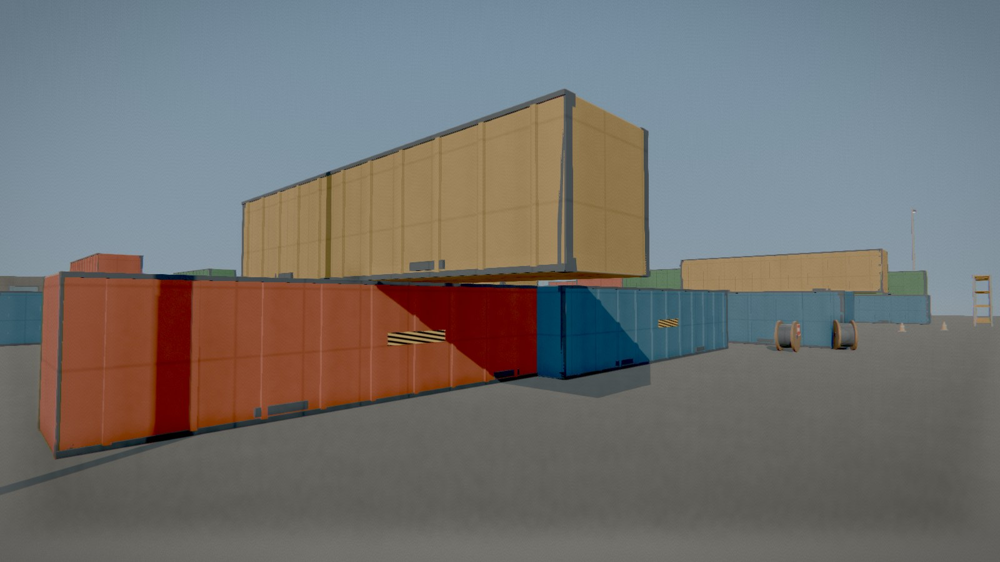
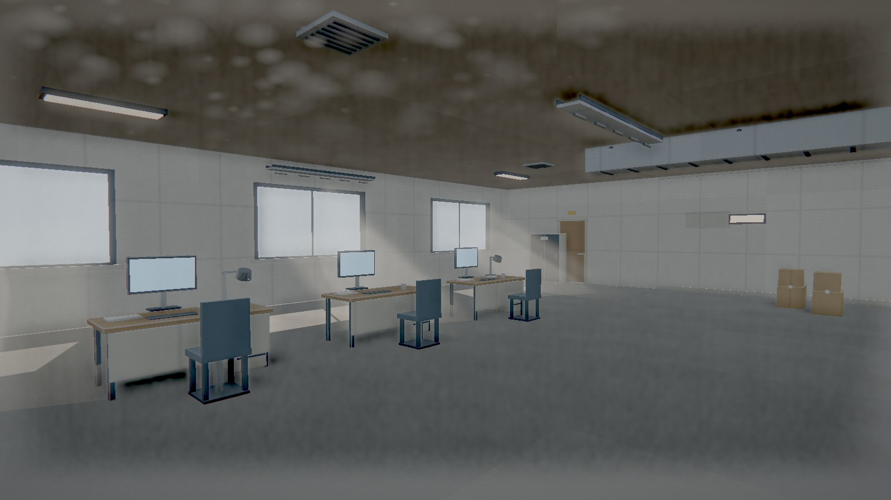

# Procedural Scene Kit

**Procedural 3D scenes and film-look rendering for the web. Zero asset files.**
Code-built models · Canvas/shader textures · SSAO / Bloom / volumetrics · Wet-ground reflections · Dynamic resolution

[](LICENSE)
[](https://threejs.org)
[](https://chetchanzq-afk.github.io/procedural-scene-kit/assets/kit/)



Run one command locally to see a scene yourself — see **Quick start** below.

## Gallery

More scenes from the same core — all generated by code, no model or texture files.

| Daylight · port yard | Daylight · office interior |
|---|---|
|  |  |

*The daylight yard reuses the rainy-night layout with a different theme; the office is a separate scene built on the same kit.*

---

## 🎯 Why this exists

Traditional Web 3D relies on downloading `.glb` models and `.png/.jpg` textures. That brings three problems: **large asset payloads**, **slow first paint**, and **an art style that is hard to keep consistent or adjust in bulk**.

Procedural Scene Kit generates models, textures, lighting and post-processing **at runtime**. You write code; you never touch asset files.

> **Good for:** hard-surface environments — ports, warehouses, streets, interiors, facilities, bases.
> **Not for:** characters, organics, or vegetation that need unique hand-authored art. Volumetric fog is disabled by default and needs per-scene tuning (`theme.volumetric`, 0.02–0.08).

## Quick start

Try it online (GitHub Pages):

- Port: https://chetchanzq-afk.github.io/procedural-scene-kit/assets/kit/
- Interior office: https://chetchanzq-afk.github.io/procedural-scene-kit/examples/indoor-office/

Run locally — no build step:

```bash
cd assets/kit
python -m http.server 8877
# open http://127.0.0.1:8877/?theme=port-dawn
# or daylight: http://127.0.0.1:8877/?theme=port-day
```

Another example:

```bash
cd examples/indoor-office
python -m http.server 8877
```

> Examples load three.js r180 from a CDN via importmap. For offline use, point the importmap in `index.html` to local files.

## Use as a starter project

Copy `assets/kit/` into your project and replace three things to get a new scene:

- `src/props.js` — prop library
- `src/scene-*.js` — layout and camera
- `src/themes.js` — lighting, fog, palette, post FX

The core modules (`kit / mesh / materials / pipeline / quality / shafts / weather`) stay untouched.

<details>
<summary>Use as an Agent Skill</summary>

This repository is also a `SKILL.md` skill. Once installed, you can ask an agent to "build a rainy-night port" and it will follow the documented pipeline.

| Harness | Install path |
|---|---|
| Trae (CN / International) | `~/.trae-cn/skills/` or `~/.trae/skills/`; project `.trae/skills/` |
| Claude Code | `~/.claude/skills/`; project `.claude/skills/` |
| Codex CLI | project `.agents/skills/`; user `~/.agents/skills/`; enterprise `/etc/codex/skills/` |
| Other harnesses | Inject `SKILL.md` into the system prompt and expose file reading |

One-line install:

```bash
./scripts/install.sh trae-cn
powershell -File scripts\install.ps1 -Target codex-user
```

Supported targets: `trae-cn`, `trae`, `claude`, `codex-user`, `codex-project`.

See [docs/harness-install.md](./docs/harness-install.md) for details.

</details>

## Project structure

```
procedural-scene-kit/
├── SKILL.md                    Agent skill: workflow, API, acceptance, pitfalls
├── references/                 01 spec · 02 mesh · 03 materials · 04 lighting · 05 performance · 06 recipes · 07 fidelity loop · 08 auto generation
├── assets/kit/                 Runnable core + port example
├── examples/indoor-office/     Daylight office example
├── docs/
│   ├── hero-16x9.jpg
│   ├── gallery-day.jpg
│   ├── gallery-interior.jpg
│   └── harness-install.md
├── scripts/
│   ├── install.sh
│   └── install.ps1
├── THIRD-PARTY-NOTICES.md
└── LICENSE
```

## Fidelity tiers

| Tier | Triangles | Use |
|---|---|---|
| Draft | 20k–40k | Block out composition and lighting |
| Standard | 80k–150k | Deliverable demo |
| High | 200k–400k | Benchmarked against commercial work |

Bundled examples: port ≈ 200k triangles, interior ≈ 12k. Iteration workflow: `references/07-fidelity-loop.md`.

## License

MIT — see [LICENSE](./LICENSE). Third-party dependencies: [THIRD-PARTY-NOTICES.md](./THIRD-PARTY-NOTICES.md).
